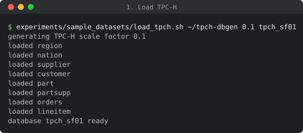
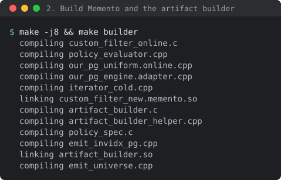
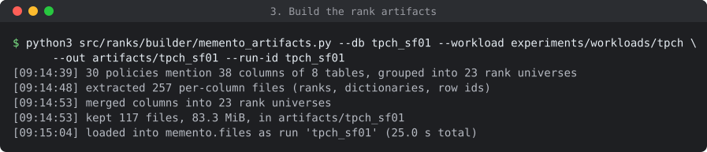
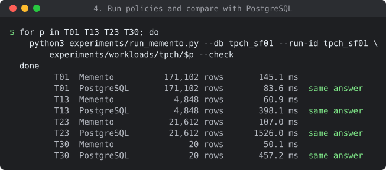

# Memento

Memento enforces parametric content-based row-level policies inside PostgreSQL.
A row is visible when related rows in other tables exist or do not exist, and the
policy's operators and constants are bound only at query time.
Additional experiments, implementation details, and proofs of stated Lemmas and
Theorems in the paper are given in [the paper with its appendix](docs/paper_with_appendix.pdf).

Instead of compiling each policy into joins, semijoins and antijoins, Memento makes
decisions the unit of work. It compiles a policy into an AND/OR decision graph,
decides each target row by a walk that stops at the first witness, and stores each
decision under the ranks it depends on, so later rows reuse it instead of reading
the data again. All of this runs over dense, order-preserving ranks built once,
offline, for every binding of every policy.

This repository holds the engine, the offline artifact builder, and every workload
of the paper's experiments.

## Repository layout

| Folder | Contents | Paper |
|---|---|---|
| `src/policy/` | policy specification, Boolean form, evaluator | Section 2 |
| `src/decision_graph/` | the AND/OR decision graph compiled from a policy | Section 4.2 |
| `src/walk/` | the walk from each target row, its tight and block loops | Section 4.3 |
| `src/decision_store/` | the rank decision store, summaries and witnesses | Section 4.3 |
| `src/ranks/` | rank universes, posting positions, artifact format | Section 5.1 |
| `src/ranks/builder/` | the offline builder of the rank artifacts | Section 5.1 |
| `src/reuse/` | reuse beyond exact keys: composed windows, envelopes, kept chains | Section 5.2 |
| `src/shared/` | shared walks across branches: request masks, collective fill | Section 5.3 |
| `src/admission/` | memory budget for summaries | Appendix D |
| `src/postgres/` | the PostgreSQL extension and the paper's engine settings | Appendix D |
| `experiments/workloads/` | all 113 policies, for Memento and for every baseline | Section 6, Appendix B |
| `experiments/sample_datasets/` | TPC-H generation and loading | Section 6.1 |
| `docs/paper_with_appendix.pdf` | the paper with its appendix: additional experiments, implementation details, proofs | |
| `docs/figures/` | the terminal runs shown below | |

## Requirements

* Linux on x86-64
* PostgreSQL 16 with server headers (`postgresql-server-dev-16` on Debian and Ubuntu)
* GCC with C++17, GNU make, Python 3.8 or newer (standard library only)
* The TPC-H `dbgen` tool from [tpc.org](https://www.tpc.org/tpc_documents_current_versions/current_specifications5.asp)

The `psql` client must reach the server as a user that may `LOAD` libraries and
create C functions (a superuser). Set `PGHOST`, `PGPORT` and `PGUSER` as usual.

## Quick start: TPC-H at scale factor 0.1

The four steps below take about two minutes. Every figure is a real terminal run.

**1. Load TPC-H.** The loader runs `dbgen` and loads the tables in file order,
with the column types of the paper's databases.

```
experiments/sample_datasets/load_tpch.sh ~/tpch-dbgen 0.1 tpch_sf01
```



**2. Build.** `make` builds the extension, `make builder` the artifact builder.
Both compile for the machine they run on (`-march=native`).

```
make -j8 && make builder
```



**3. Build the rank artifacts.** The builder reads which columns the policies
mention, never their operators or constants, so one build serves every binding.
It ranks those columns, merges compared columns into one rank universe, and loads
the result into the table `memento.files`.

```
python3 src/ranks/builder/memento_artifacts.py --db tpch_sf01 \
    --workload experiments/workloads/tpch --out artifacts/tpch_sf01 --run-id tpch_sf01
```



**4. Run policies.** `--check` also runs the same policy as plain SQL in
PostgreSQL and compares the answers.

```
for p in T01 T13 T23 T30; do
    python3 experiments/run_memento.py --db tpch_sf01 --run-id tpch_sf01 \
        experiments/workloads/tpch/$p --check
done
```



T01 is a one-table policy, where PostgreSQL's plain filter is hard to beat. The
other three reach other tables, and Memento's reuse of decisions pays off.
Times at this small scale only illustrate. The paper's numbers come from the
setup of Section 6.

## Policy format

Each policy folder holds the policy in the form Memento reads, and the same
policy for the baselines.

| File | Used by | Contents |
|---|---|---|
| `policy_template.txt` | Memento | target table, table occurrences, atoms with operator and value slots |
| `policy_binding.txt` | Memento | the Boolean formula over the atoms, and the operators and constants of this binding |
| `query.txt` | Memento | the user query |
| `ours_exact_policy.txt` | reference | the policy as one SQL predicate on the target table |
| `query.sql` | all | the user query, without the policy |
| `correlated.sql` | PostgreSQL, DuckDB, Umbra | the policy as correlated subqueries |
| `decorrelated.sql` | PostgreSQL, DuckDB, Umbra | the policy rewritten by hand into joins |
| `view_query.sql` | PostgreSQL views | the query on the policy view |

For example, TPC-H policy T05 hides a line item when its supplier holds fewer than 3,000 units of the part:

```
$ cat experiments/workloads/tpch/T05/policy_template.txt
policy 1
target: lineitem
atom a1: partsupp.ps_partkey @op1 lineitem.l_partkey
atom a2: partsupp.ps_suppkey @op2 lineitem.l_suppkey
atom a3: partsupp.ps_availqty @op3 @value1
end
$ cat experiments/workloads/tpch/T05/policy_binding.txt
query: q1
1.ast = NOT EXISTS ((a1 AND a2 AND a3))
1.op1 = EQ
1.op2 = EQ
1.op3 = LT
1.value1 = 3000
```

A new binding changes only `policy_binding.txt`. The artifacts stay the same.

## Reproducing the paper

| Suite | Policies | Database | Paper |
|---|---:|---|---|
| `tpch` | 30 | TPC-H, scale factors 0.1, 1, 10 and 100 | Sections 6.2 and 6.4 |
| `mimic` | 30 | MIMIC-IV | Section 6.2 |
| `job` | 30 | IMDB (Join Order Benchmark) | Section 6.2 |
| `multiplicity` | 10 | TPC-H 10 with grouped copies of customer and supplier | Section 6.3 |
| `nested` | 13 | TPC-H 1 and 10 | Section 6.3 |

Build the artifacts once per database with the suite's folder as `--workload`,
then run each policy as in step 4. MIMIC-IV needs credentialed access from
[PhysioNet](https://physionet.org/content/mimiciv/), so this repository holds its
policies but no data.
